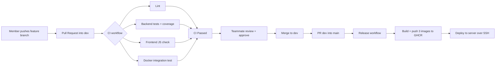

# CI/CD Pipeline

## Overview


## Workflows
| File | Runs when | What it does |
|---|---|---|
| `.github/workflows/ci.yml` | every PR and every push to `main` / `dev` | lint, tests (with coverage summary), frontend check, full Docker stack + `scripts/smoke-test.sh`, Terraform validate (info only), then the single gate job **CI Passed** |
| `.github/workflows/deploy.yml` | a merge into `main` | builds and pushes `booking-service`, `payment-service`, `frontend` images to GitHub Container Registry; deploys over SSH **only when** the repo variable `DEPLOY_ENABLED` is `true` |
| `.github/dependabot.yml` | weekly | opens PRs for outdated pip packages, Docker base images and GitHub Actions |

Also in `.github/`: `CODEOWNERS` (auto-requests the right reviewer), the PR template and issue templates.

## One-time setup (the repo owner, about 15 minutes)
1. **Create the repo** on GitHub (public is simplest; private needs GitHub Pro / Student Pack for branch protection). Push the project to `main`:
   ```bash
   git init && git add . && git commit -m "chore: initial project"
   git branch -M main
   git remote add origin https://github.com/<you>/fest-ticketing.git
   git push -u origin main
   ```
2. **Invite the 4 teammates:** Settings > Collaborators > Add people (role: Write).
3. **Edit `.github/CODEOWNERS`:** replace `@MEMBER1` ... `@MEMBER5` with real GitHub usernames. Do the same in the roles table in `CONTRIBUTING.md`.
4. **Set up branches, labels and protection**, either automatically:
   ```bash
   gh auth login
   bash scripts/setup-github.sh
   ```
   or by hand: Settings > Branches > add a rule for `main` and for `dev` with
   *Require a pull request before merging* (1 approval, dismiss stale approvals),
   *Require status checks to pass* (choose **CI Passed**), and *Do not allow force pushes*.
   (The check name only appears in the list after CI has run once, so push first.)
5. **Enable Actions package publishing:** Settings > Actions > General > Workflow permissions > *Read and write permissions*.
6. **Optional, when you have a server:** add secrets `DEPLOY_HOST`, `DEPLOY_USER`, `DEPLOY_SSH_KEY` and a repository **variable** `DEPLOY_ENABLED` = `true` (Settings > Secrets and variables > Actions). Until then the deploy job is skipped, so `main` stays green.
7. **Each teammate:** `git clone` the repo, then follow `CONTRIBUTING.md`.

## Using GitHub Projects for tracking
Create a Project (board) with columns *To do / In progress / In review / Done*, add the repo's issues, and assign each task to one member. Moving cards and linking PRs (`Closes #n`) gives a clear record of who did what.

## What to show at the expo
1. The **Actions** tab: a green CI run with its 4 jobs, and the coverage summary on the run page.
2. A **Pull Request**: the review comment, the approval from a teammate and the green "CI Passed" check.
3. **Settings > Branches**: `main` and `dev` protected.
4. The **Packages** section of the repo: the 3 images pushed by the Release workflow.
5. **Insights > Contributors** and the commit history: everyone's work.

## Troubleshooting
| Problem | Fix |
|---|---|
| `CI Passed` is not in the required-checks list | Run CI once (open any PR or push), then pick it |
| Lint fails | Run `flake8 booking-service payment-service` locally and fix what it prints |
| Integration job fails | Open the job log: the last step prints the container logs. Reproduce with `docker compose up -d --build && bash scripts/smoke-test.sh` |
| Release job cannot push images | Step 5 above (workflow permissions) |
| `smoke-test.sh: bad interpreter` on Windows | The repo's `.gitattributes` keeps Unix line endings; re-clone, or run `git add --renormalize .` |
| You can't approve your own PR | Expected: ask a teammate (the lead can merge as admin in an emergency) |
